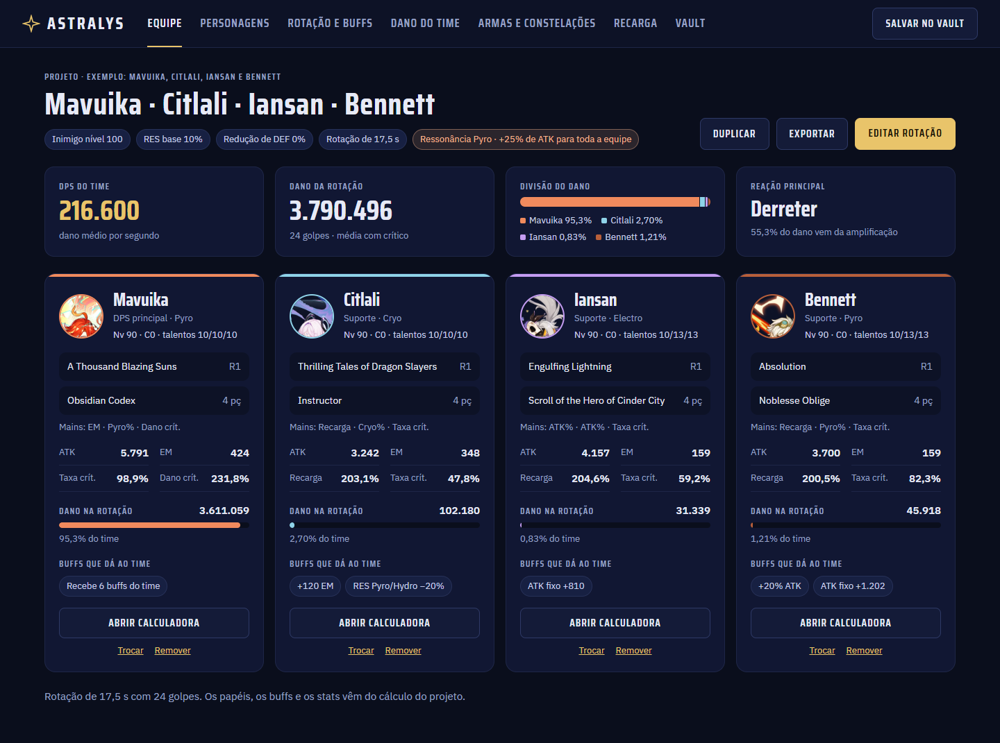
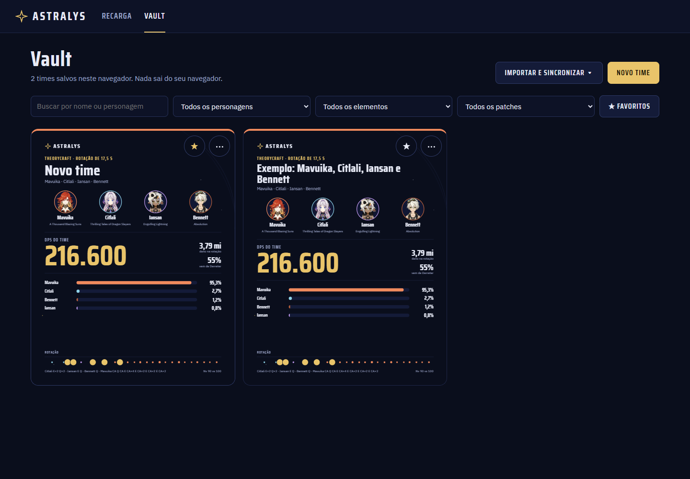
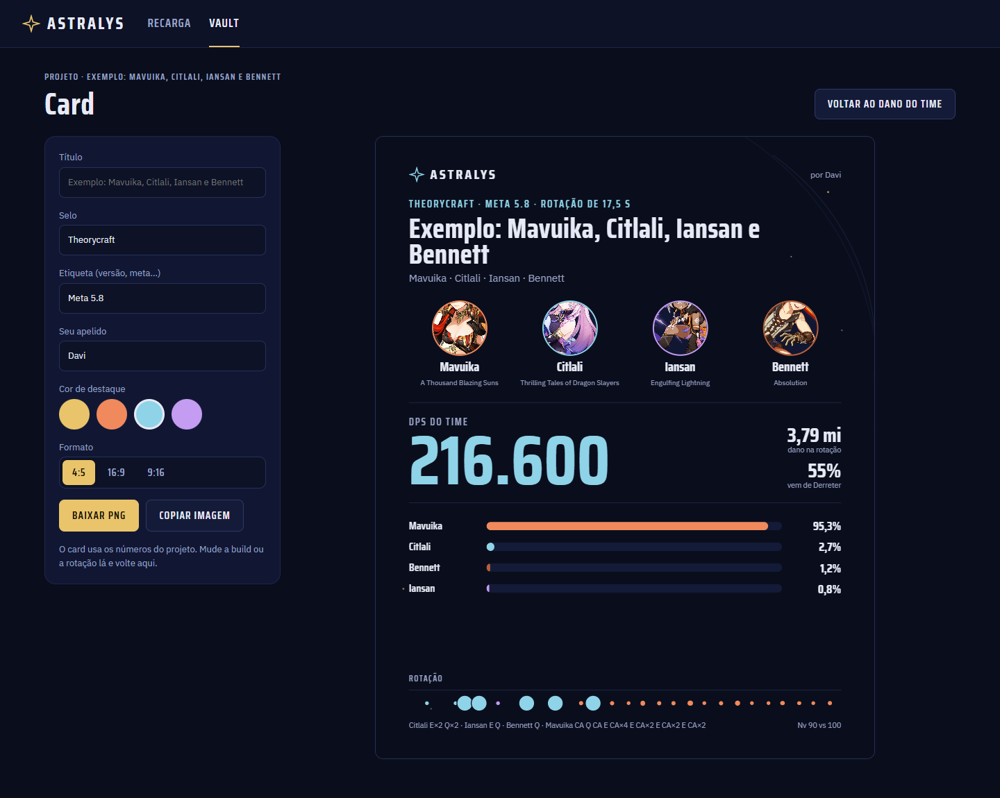

# Astralys

**Teorycraft de Genshin Impact que mostra de onde vem cada número.**
Monte um time, coloque a rotação numa linha do tempo e veja quanto dano cada personagem, cada buff e cada reação realmente rende.

### 👉 [astralys.vercel.app](https://astralys.vercel.app)

<p align="center">
  
</p>

---

## Para que serve

Calculadoras de dano costumam dar um número e pronto. O Astralys foi feito para responder **"por quê?"**:

- **Quanto vale cada buff?** Desmarque um buff e veja quanto do dano do time some.
- **De onde vem o dano?** Divisão por personagem, por fonte (golpe, reação, dano fixo) e por tipo de golpe.
- **Qual é a melhor build com o que eu tenho?** Importe seu inventário e busque o melhor conjunto de artefatos.
- **Compartilhe.** Gere um card em imagem (4:5, 16:9 ou 9:16) ou um link para o time.

O motor reproduz uma planilha de theorycraft de referência com precisão total (DPS 216.600 e dano de rotação 3.790.496 no time de exemplo) e segue as fórmulas do [Genshin Optimizer](https://github.com/frzyc/genshin-optimizer).

## Como usar (5 passos)

1. **Abra o [Vault](https://astralys.vercel.app/vault)** e clique em **Novo time** (ou abra o exemplo, que já vem pronto).
2. **Equipe:** veja os 4 personagens, o dano de cada um e o que cada um dá ao time.
3. **Personagens:** ajuste constelação, talentos, arma, artefatos e substats. Em *Ferramentas*, importe seu build real pelo **UID do jogo** ou pelo arquivo do Genshin Optimizer.
4. **Rotação e buffs:** arraste os golpes na linha do tempo e ligue os buffs nas janelas em que valem.
5. **Dano do time:** leia o resultado (DPS, dano por personagem, reações) e gere o **Card** para compartilhar.

## Telas

| Tela | O que faz |
| --- | --- |
| **Equipe** | Visão do time: DPS, divisão do dano, reação principal e um cartão por personagem. |
| **Personagem** | Constelação, talentos, arma, artefatos, substats (otimizados ou à mão), tabela de dano de todo o kit, buffs recebidos e ferramentas. |
| **Rotação e buffs** | Linha do tempo dos golpes, janelas de buff arrastáveis e cascata de multiplicadores de cada golpe. |
| **Dano do time** | Curva de dano acumulado, dano por fonte, valor de cada buff e os 10 maiores golpes. |
| **Armas e constelações** | Compare todas as armas do tipo do personagem, refinamentos R1 a R5 e constelações C0 a C6. |
| **Recarga** | Quanta recarga de energia cada personagem precisa (dentro do projeto ou avulsa). |
| **Vault** | Todos os seus times, cada um como um card. Favoritos, busca, filtro por patch, importar planilha `.xlsx` ou projeto `.json`. |
| **Card** | Imagem para compartilhar, com título, selo, apelido e cor de destaque. |
| **Comparar** | Dois times lado a lado (DPS, dano e build por personagem). |

<p align="center">
  
  
</p>

## Importar o seu build

- **Pelo UID do jogo** (Enka.Network, a mesma fonte do akasha.cv): em *Personagem → Ferramentas → Inventário GOOD → Buscar pelo UID*. Traz até 8 personagens da sua vitrine, com arma e as 5 peças reais. A vitrine do jogo precisa estar com os detalhes visíveis.
- **Pelo Genshin Optimizer:** exporte o inventário no formato GOOD e importe o arquivo. O Astralys ainda busca o melhor conjunto de artefatos do inventário para a rotação.
- **Planilha:** importe uma planilha de theorycraft no formato do exemplo (`.xlsx`).

Esse recurso precisa do backend (veja abaixo). Sem ele, o resto do site funciona normalmente.

## Conta online (opcional)

Crie uma conta para guardar os times fora do navegador, sincronizá-los entre dispositivos e **compartilhar um time por link** (`/p/...`) que qualquer pessoa abre sem login. Sem conta, tudo fica só no seu navegador.

## De onde vêm os números

| Dado | Fonte |
| --- | --- |
| Personagens, armas, artefatos e multiplicadores de golpe | [Lunaris](https://lunaris.moe) (API não oficial) |
| Fórmulas de dano e reações | Genshin Optimizer (MIT), camada `libs/gi/wr` |
| Efeitos de passivas, constelações, armas e sets | Curadoria própria, sempre com o texto/parâmetro do Lunaris e uma nota do que foi assumido |
| Builds reais pelo UID | Enka.Network |

**Regra do projeto:** nenhum número de jogo é inventado. Quando algo é uma premissa (por exemplo, "stacks no máximo"), isso aparece na nota do efeito. As pendências estão em [`docs/DECISOES_PENDENTES.md`](docs/DECISOES_PENDENTES.md).

### O que ainda não é modelado

Dano Físico como elemento, redução de DEF por buff, reações Lunares e Estelares por Moonsign e alguns efeitos de personagens novos. A lista completa e o porquê estão nas decisões pendentes. As partículas de energia da habilidade vêm de uma tabela ainda não verificada.

## Tecnologia

- **Frontend:** React 18, Vite, TypeScript, React Router, Zustand, TanStack Query, Zod. CSS próprio (sem Tailwind).
- **Motor:** TypeScript puro em `src/engine/` (sem React), roda num Web Worker.
- **Testes:** Vitest (574 testes, incluindo o gabarito da planilha) e roteiros de ponta a ponta com Playwright em Edge.
- **Backend (opcional):** [Astralys-BackEnd](https://github.com/Fushyki/Astralys-BackEnd), FastAPI + SQLAlchemy + JWT, com proxy do Enka.
- **Hospedagem:** Vercel (site) e Render (API e banco PostgreSQL).

## Rodar localmente

```bash
git clone https://github.com/Fushyki/Astralys.git
cd Astralys
npm install
npm run dev          # http://localhost:5173
```

Comandos úteis:

```bash
npm test             # Vitest (motor, dados e telas)
npx tsc --noEmit     # checagem de tipos
npm run build        # build de produção em dist/
npm run sync:data    # baixa os dados do Lunaris e gera src/data/generated/
```

Testes de ponta a ponta (precisam do build rodando em `localhost:4173` e do Edge):

```bash
npm run build && npx vite preview --port 4173
npm run e2e
```

### Com a conta online

Defina a URL da API no build: `VITE_API_URL=http://localhost:8000` (veja `.env.example`). **Sem essa variável nenhum botão de conta aparece.** O passo a passo para subir o backend local e rodar `npm run e2e:conta` está em [`CLAUDE.md`](CLAUDE.md).

## Estrutura

```
src/engine/      motor de dano (puro, testado contra a planilha de referência)
src/effects/     efeitos de passivas, armas e sets (JSON com a fonte de cada número)
src/data/        dados do jogo gerados pelo sync (não editar à mão)
src/design/      sistema de design (tokens, componentes, gráficos)
src/screens/     as telas
src/features/    lógica de cada tela, pura e testada
src/online/      conta, sincronização e Enka
scripts/         sync de dados, curadoria de efeitos e roteiros e2e
reference/       planilha de referência (gabarito, só leitura)
docs/            decisões, imagens e notas
```

Notas para quem mantém o projeto (regras, estado das fases, como cada parte funciona) estão em [`CLAUDE.md`](CLAUDE.md).

## Aviso

Astralys é um projeto de fãs e **não é afiliado à HoYoverse**. Genshin Impact e os nomes e imagens dos personagens pertencem à HoYoverse. Os dados vêm de serviços de terceiros que podem mudar sem aviso. Os avisos das bibliotecas e fontes usadas estão em [`THIRD_PARTY_NOTICES.md`](THIRD_PARTY_NOTICES.md).
