# Redesign do Astralys: fluxo em telas, Vault de times e Card 4:5

Branch `v2/redesign` (sai de `v2/core`). Refaz toda a interface a partir de `ASTRALYS_REDESIGN_PROMPT.md` e dos mockups, **sem mexer no motor**: o gabarito da planilha continua exato (DPS 216.600 e DPR 3.790.496 aparecem em todas as telas onde existem).

## O que mudou
Fluxo em telas separadas (um commit por tela):

| Tela | Rota | Desktop (1440) | Celular (390) |
|------|------|----------------|---------------|
| Equipe | `/projeto/:id` |  | 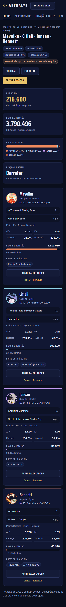 |
| Personagem | `/projeto/:id/personagem/:nome` | 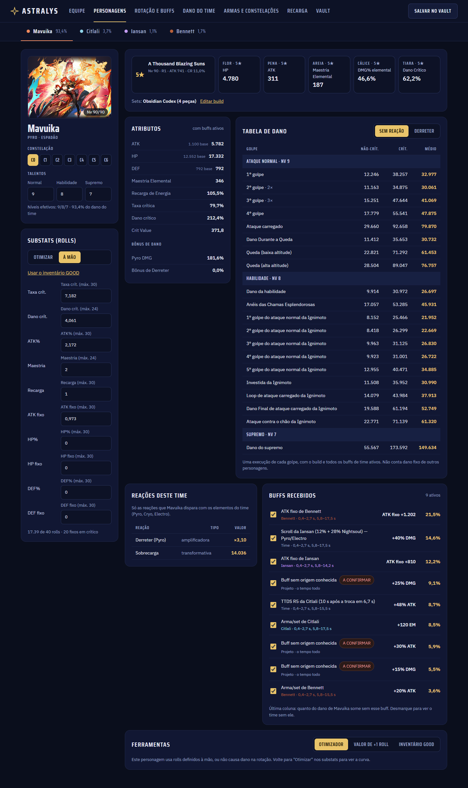 | 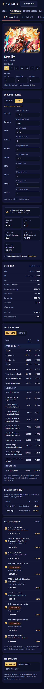 |
| Rotação e buffs | `/projeto/:id/rotacao` | 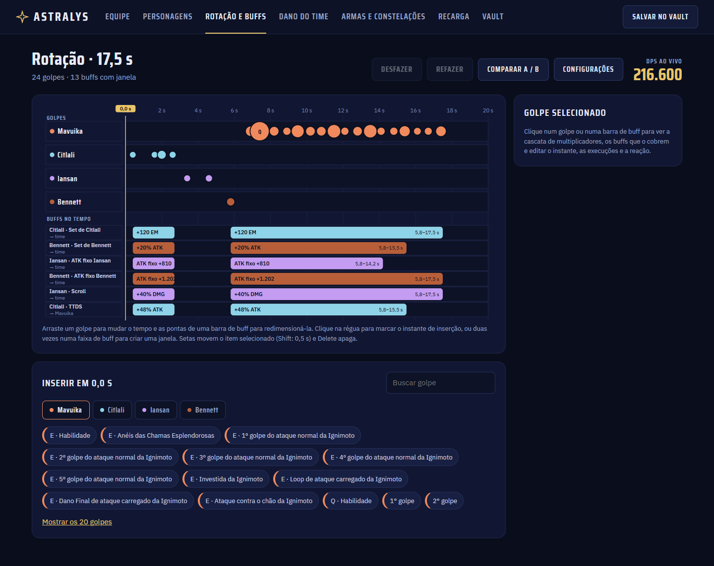 | 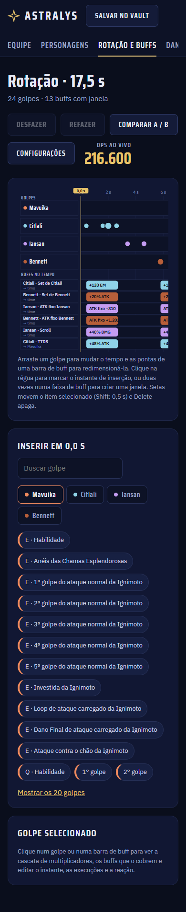 |
| Dano do time | `/projeto/:id/time` | 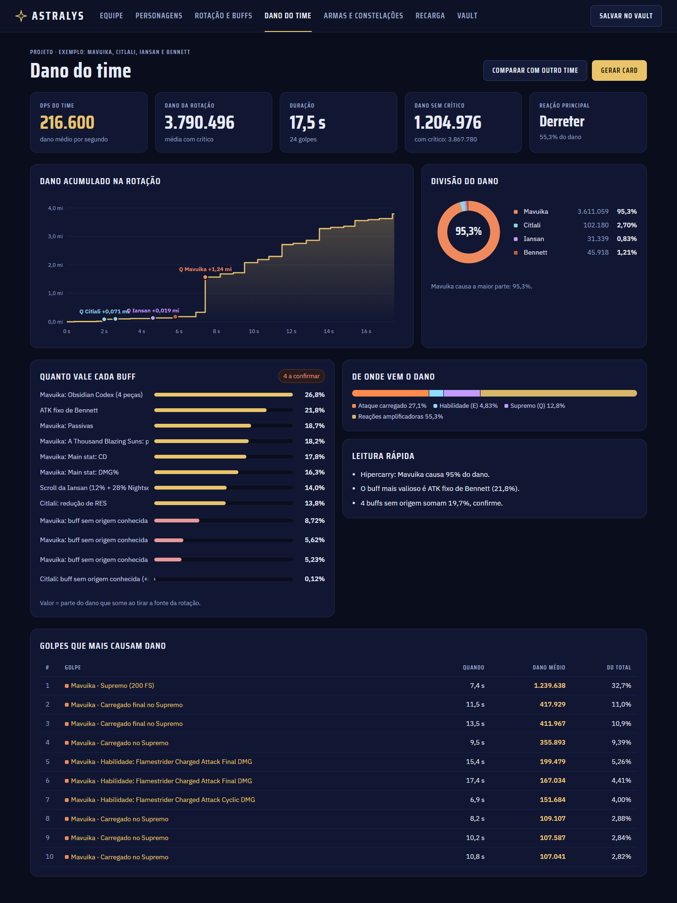 | 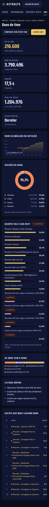 |
| Armas e constelações | `/projeto/:id/armas/:nome?` | 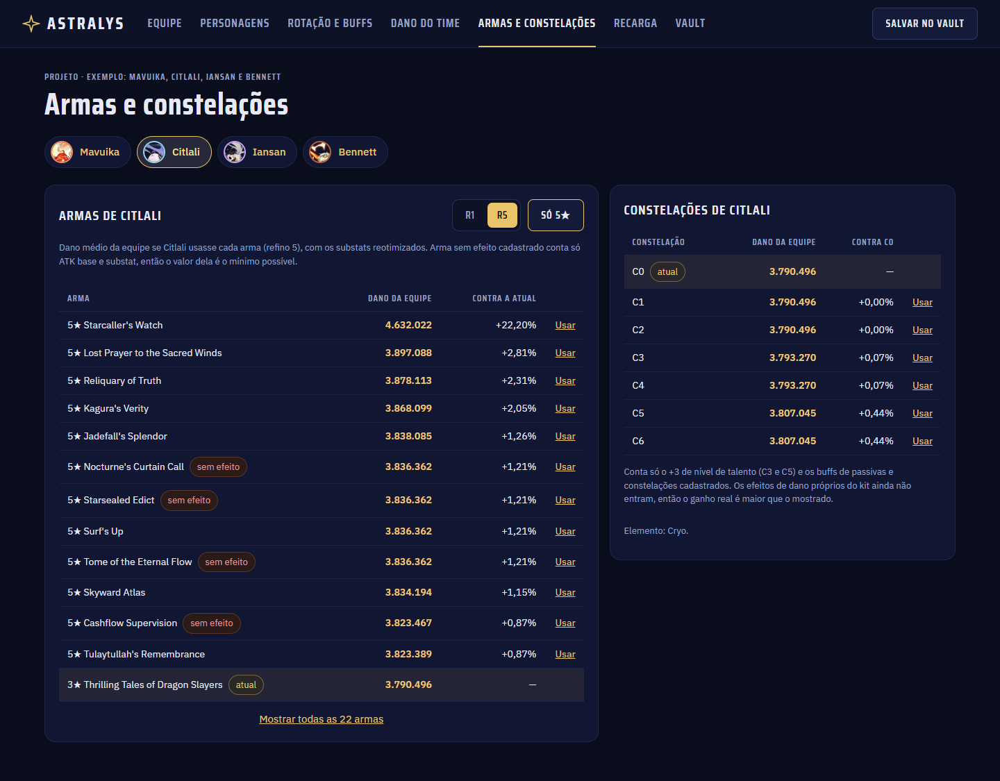 | 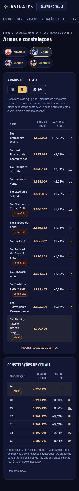 |
| Recarga | `/projeto/:id/recarga` e `/recarga` | 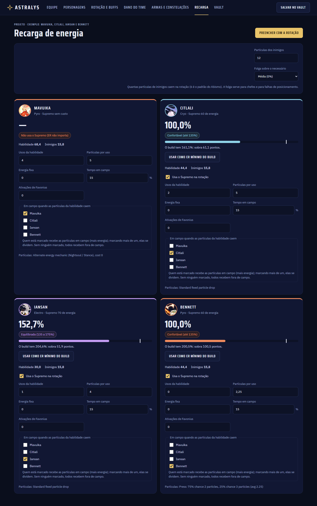 | 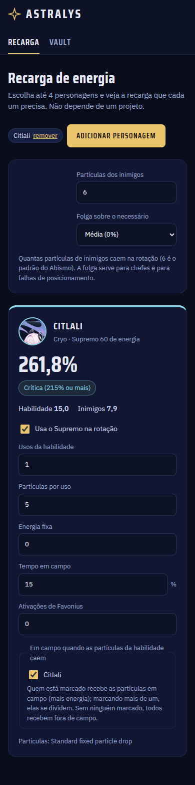 |
| Vault | `/vault` |  | 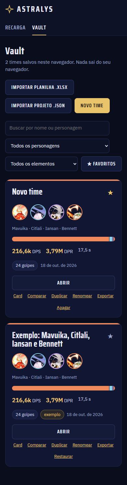 |
| Card | `/card/:id` |  | 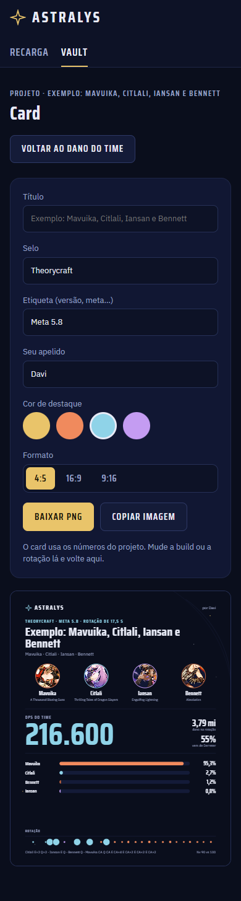 |

Card em 16:9 e 9:16: `redesign/card-16x9.png`, `redesign/card-9x16.png`. Comparar A/B: `redesign/comparar-1440.png`. Home: `redesign/inicio-390.png`.

- Design system em `src/design/` (tokens, componentes `dz-*`, gráficos SVG), CSS próprio com variáveis, fontes Saira Condensed e IBM Plex Sans.
- Vault = todos os times; o cartão é o mesmo da Equipe. "Salvar no Vault" favorita e leva ao Vault.
- Recarga virou aba própria; avulsa (`/recarga`) ou dentro do projeto (preenche usos pela rotação e grava o ER mínimo).
- Card: 4:5 (1080×1350) padrão, 16:9 e 9:16 mantidos, apelido e cor de destaque, PNG no tamanho real.
- Rotas antigas `/rotacao*` redirecionam; interface antiga removida (`ast.css`, `RotationPage`, `ProjectsPage`, editor de build antigo etc.).
- Único acréscimo ao motor: `RotationProject.disabled` (desligar um buff por fonte); lista vazia não muda nenhum resultado.

## Como verifiquei
`npx tsc --noEmit`, `npm test` (532 testes), `npm run build`, `npm run e2e` (9 roteiros, 168 verificações em Edge, desktop e celular, sem rolagem horizontal e sem erros de console).

## Pendências e itens para confirmar (detalhes em `docs/DECISOES_PENDENTES.md`, 15 a 26)
- **Números dos mockups são ilustrativos**: nada foi copiado; tudo vem do motor (ex.: a base do Supremo da Mavuika é 79.724,66, não 79.403; a linha do tempo real tem 6 faixas de buff, não 7).
- "Exportar GOOD" do mockup exporta o projeto do Astralys (GOOD é formato de inventário, só importamos).
- "Reotimizar / Manter build" (Armas) **não implementado**: falta definir o que "manter" faz no motor.
- Filtro por patch no Vault não existe (projetos não guardam patch).
- Home sem mockup: refeita com o mesmo visual, diga se quer outra coisa.
- O Lunaris não tem ícone do Viajante (404 esperado, cai na inicial).
- Ainda valem os itens 1 a 14 do PR anterior (efeitos curados, partículas não verificadas, GOOD sem arquivo real).

🤖 Generated with [Claude Code](https://claude.com/claude-code)
